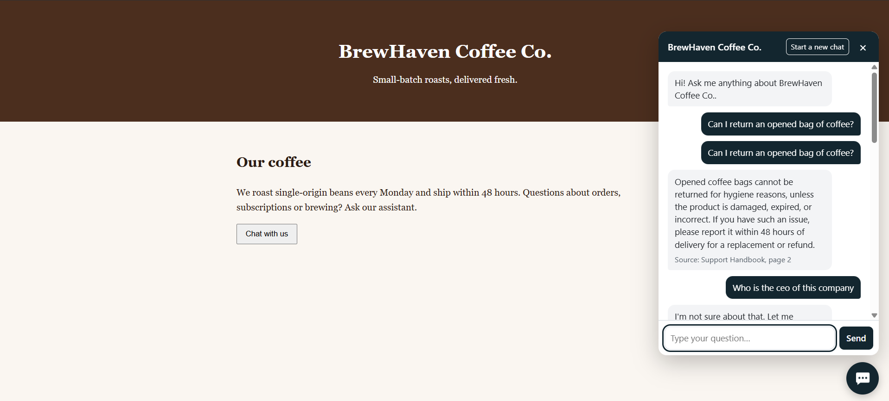
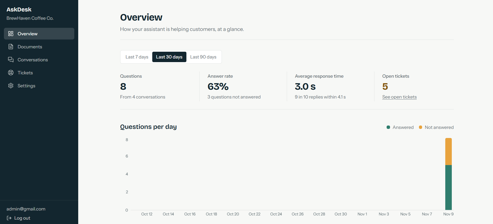
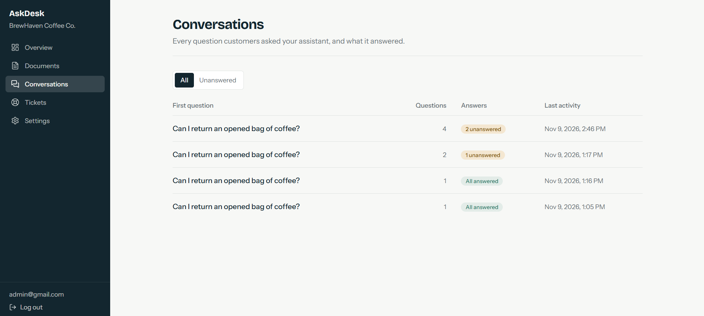
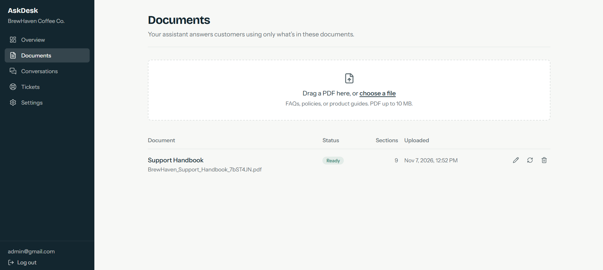
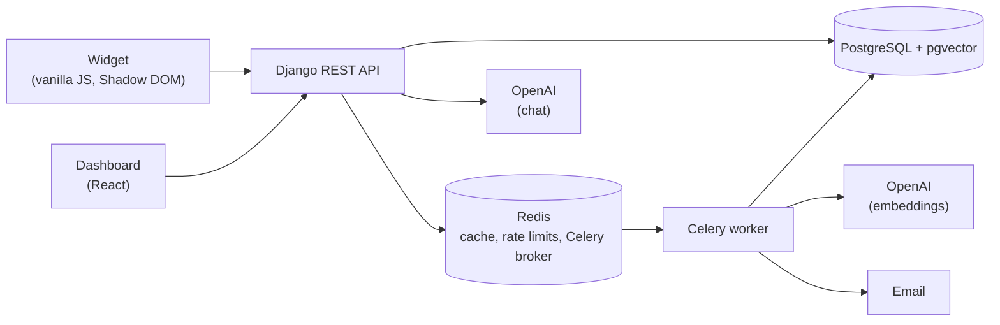

# AskDesk


AI customer support platform: businesses upload their documents and embed a chat widget that answers customers from those documents, with citations, and hands unanswered questions to their team.

Live demo: TODO
Demo video: TODO

## Screenshots

| Chat widget | Dashboard overview |
| --- | --- |
|  |  |
| **Conversations** | **Documents** |
|  |  |

## Features

**For customers**
- Embeddable chat widget that drops into any website with one script tag
- Streaming answers, token by token
- Citations that point back to the source documents
- Contact-support form when the assistant can't answer

**For business owners**
- Document upload with live processing status
- Conversation history with an unanswered filter
- Support tickets with email notifications
- Analytics overview
- Widget settings

**Platform**
- Multi-tenant isolation: every business sees only its own data
- JWT authentication with token refresh
- Rate limiting on public endpoints
- Domain-restricted API keys for the widget

## Architecture



### How a question is answered

1. Embed the question (embeddings are cached in Redis).
2. Run a top-5 cosine similarity search in pgvector, filtered to that business.
3. **Layer 1:** if even the best chunk's distance is above `RETRIEVAL_MAX_DISTANCE` (default 0.70), skip the LLM and return the fallback reply.
4. The LLM answers only from the numbered sources and cites them as `[1]`, `[2]`, ...
5. **Layer 2:** detect the model's own fallback reply. The server holds back the first 20 characters, so a fallback is never streamed to the user.
6. Stream tokens to the widget over Server-Sent Events.
7. Save the conversation. Unanswered questions offer a ticket form, and Celery emails the owner.

### How documents are processed

1. Upload a PDF; a Celery task picks it up.
2. Extract text per page with pypdf.
3. Section-aware chunking: detect headings, keep whole sentences, aim for about 300 tokens, and prefix each chunk with its heading.
4. Embed chunks with OpenAI (1536 dimensions).
5. Store them in pgvector with an HNSW index (cosine distance).

## Evaluation

Run on 2026-11-09 with `gpt-4o-mini` (chat) and `text-embedding-3-small` (embeddings), `RETRIEVAL_MAX_DISTANCE` = 0.70.

| Metric | Result |
| --- | --- |
| Answer accuracy (answerable questions) | 94.6% |
| Correct refusals (unanswerable questions) | 100% |
| Hallucinations | 0 |
| False refusals | 2 |
| Retrieval hit@1 | 94.6% |
| Retrieval hit@3 | 100% |
| Average latency | 1,873 ms |
| p90 latency | 2,252 ms |

**Method.** 47 questions (37 answerable, 10 unanswerable) on a sample support handbook. An answer passes only if it contains every required key phrase. Unanswerable questions must be refused.

```bash
python manage.py run_eval eval/brewhaven_eval.json --business <slug> --clear-cache
```

Reports are written to `eval/reports/`.

Switching from fixed-size to section-aware chunking reduced average retrieval distance by 21% on the same questions.

**Limitations.** Keyword checks can mark a correct answer with unexpected wording as a failure, and the question set is small.

## Tech stack

- **Backend:** Django, Django REST Framework, PostgreSQL + pgvector, Celery, Redis, OpenAI API, drf-spectacular
- **Frontend:** React, Vite, Tailwind CSS v4, React Router, Axios, Recharts
- **Widget:** vanilla JS, Shadow DOM, about 6 KB gzipped

## Project structure

```
askdesk/
├── config/       Django settings, root URLs, Celery app
├── accounts/     Users, registration, JWT login
├── tenants/      Businesses, API keys, widget settings
├── documents/    PDF upload, chunking, embeddings
├── chat/         RAG pipeline, streaming answers, conversations
├── tickets/      Support tickets and email notifications
├── analytics/    Dashboard overview metrics
├── eval/         Evaluation dataset, run_eval reports
├── frontend/
│   ├── dashboard/  React dashboard for business owners
│   └── widget/     Embeddable chat widget
└── docs/         Screenshots
```

## Getting started

### Prerequisites

- Python 3.12
- PostgreSQL 16+ with the pgvector extension
- Redis (Memurai on Windows)
- Node 20+
- An OpenAI API key

### Backend

```bash
git clone <repo-url> askdesk
cd askdesk
python -m venv venv
source venv/bin/activate        # Windows: venv\Scripts\activate
pip install -r requirements.txt
cp .env.example .env            # then fill in your values
createdb askdesk
python manage.py migrate
python manage.py createsuperuser
python manage.py runserver
```

### Celery worker

In a second terminal (with the venv active):

```bash
celery -A config worker -l info
# Windows: celery -A config worker -l info --pool=solo
```

### Dashboard

```bash
cd frontend/dashboard
npm install
npm run dev                     # http://localhost:5173
```

### Widget

```bash
cd frontend/widget
npm install
npm run build
npm run dev                     # demo page on http://localhost:5174
```

### First run

1. Register in the dashboard.
2. Upload a PDF and wait for its status to show Ready.
3. Copy the embed code from Settings into `frontend/widget/demo.html`.
4. Open the demo page and chat.

## Embedding the widget

```html
<script
  src="https://your-askdesk-server.com/static/widget/askdesk-widget.js"
  data-api-key="YOUR_API_KEY"
  defer
></script>
```

Set your allowed domains in Settings before going live, so the key only works on your site.

## API overview

Interactive docs (Swagger UI) are at [`/api/docs/`](http://localhost:8000/api/docs/).

| Method | Path | Auth | Purpose |
| --- | --- | --- | --- |
| POST | `/api/auth/register/` | None | Create a user and business |
| POST | `/api/auth/login/` | None | Get access and refresh tokens |
| POST | `/api/auth/refresh/` | None | Refresh an access token |
| GET | `/api/auth/me/` | JWT | Current user |
| GET, POST | `/api/documents/` | JWT | List or upload documents |
| GET, PATCH, DELETE | `/api/documents/{id}/` | JWT | View, rename, or delete a document |
| POST | `/api/documents/{id}/reprocess/` | JWT | Re-run processing |
| GET | `/api/chat/conversations/` | JWT | Conversation history |
| GET | `/api/chat/conversations/{id}/` | JWT | Conversation detail |
| GET | `/api/tickets/` | JWT | List support tickets |
| GET, PATCH | `/api/tickets/{id}/` | JWT | View or update a ticket |
| GET | `/api/analytics/overview/` | JWT | Dashboard metrics |
| GET, PATCH | `/api/business/` | JWT | Business and widget settings |
| POST | `/api/chat/ask/` | API key | Ask a question (full response) |
| POST | `/api/chat/ask/stream/` | API key | Ask a question (Server-Sent Events) |
| POST | `/api/public/tickets/` | API key | Create a ticket from the widget |
| GET | `/api/public/widget-config/` | API key | Widget appearance settings |

Public endpoints are rate limited per visitor: ask 30/minute, tickets 5/hour, widget 60/minute.

## Security

- **Data isolation:** every query is scoped to the user's business; cross-business access returns 404.
- **Public API keys:** widget keys are public by design, so they are protected by allowed domains and per-visitor rate limits.
- **CORS:** enabled only for the public widget endpoints (`/api/chat/ask/` and `/api/public/`).
- **Uploads:** checked by file signature, not just extension.
- **XSS:** the widget never uses `innerHTML` for message text.
- **Tokens:** JWTs are stored in localStorage. This is a known trade-off; httpOnly cookies are a planned improvement.

## Testing

```bash
python manage.py test
```

In both `frontend/dashboard` and `frontend/widget`:

```bash
npm run lint
npm run build
```

## Limitations and roadmap

- Only PDF documents are supported.
- Follow-up questions don't use earlier messages in the conversation yet.
- Heading detection is a heuristic tuned for FAQ and policy documents.
- Planned: hybrid keyword + vector search.
- Planned: LLM-graded evaluation.

## Author

Ekansh Gupta: [LinkedIn](https://www.linkedin.com/in/ekansh-gupta-7773aa311/)
